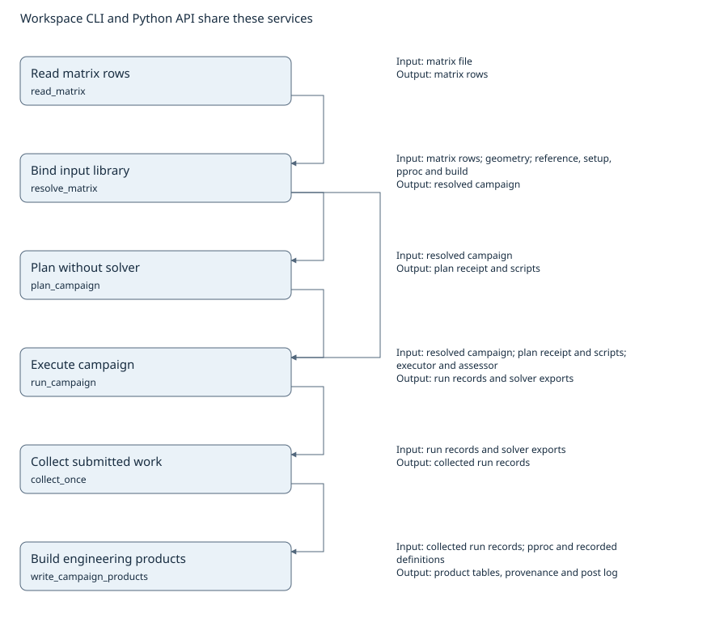
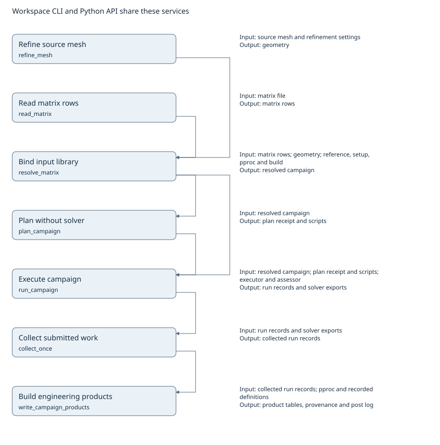

# Matrix to products

The workspace commands and Python examples call the same services. Arrows connect a declared stage output to a stage consuming that artifact. They are data dependencies, not a mandatory sequence of API calls.

Local execution collects outputs during run; the collect stage is needed for submitted work. Post reads the workspace's durable records, rather than the Python return value of collect. A successful plan does not prove solver convergence or product validity.

Stage input/output declarations live in `scripts/pipeline_graph.json`. The generator resolves each callable and records its current signature and source digest. [Machine-readable stages and edges](data-flow.json).

## Steady wing polar



Expected product family: Steady polar coefficients, sections and provenance.

- [workspace example](https://github.com/nevesgeovana/pyflightstream/blob/main/examples/using-CLI/steady-wing-polar/matrix.fs)
- [api example](https://github.com/nevesgeovana/pyflightstream/blob/main/examples/using-API/steady_wing_polar.py)

## Unsteady isolated propeller


Expected product family: Windowed rotor coefficients and configured unsteady reductions.

- [workspace example](https://github.com/nevesgeovana/pyflightstream/blob/main/examples/using-CLI/unsteady-isolated-propeller/matrix.fs)
- [api example](https://github.com/nevesgeovana/pyflightstream/blob/main/examples/using-API/unsteady_isolated_propeller.py)

## Campaign with mesh refinement



Expected product family: Comparable polar tables for the original and refined mesh.

- [workspace example](https://github.com/nevesgeovana/pyflightstream/blob/main/examples/using-CLI/mesh-refinement-campaign/matrix.fs)
- [api example](https://github.com/nevesgeovana/pyflightstream/blob/main/examples/using-API/mesh_refinement_campaign.py)

## Python stage contracts

The signatures below are read from the source on regeneration.

### Read matrix rows

```text
read_matrix(path: str | Path, *, active_only: bool=True) -> list[MatrixRow]
```

### Bind input library

```text
resolve_matrix(path: str | Path, workspace: CampaignWorkspace, *, name: str, fs_version: str | None, recipes: Mapping[str, str], fs_exe: str | Path | None=None, ignore_missing_families: bool=True, rows: list[MatrixRow] | None=None) -> ResolvedMatrix
```

### Plan without solver

```text
plan_campaign(campaign: Campaign, workspace: CampaignWorkspace, *, recipes: dict[str, ScriptRecipe] | None=None, write_plan: bool=True, name_from: str | None=None, builds: Mapping[str, SolverBuild] | None=None, versions: Mapping[str, str] | None=None, matrix_path: str | Path | None=None, accept_unregistered_build: bool=False, setup_inspections: Sequence[dict[str, object]] | None=None, inflow_fft: bool=False, accepted_builds: Collection[str]=(), planned_order: Mapping[str, Sequence[str]] | None=None) -> CampaignPlan
```

### Execute campaign

```text
run_campaign(campaign: Campaign, executor: Executor, workspace: CampaignWorkspace, *, assess: OutcomeAssessor, recipes: dict[str, ScriptRecipe] | None=None, resume: bool=False, force_rerun: Sequence[str] | None=None, preflight: bool=True, builds: Mapping[str, SolverBuild] | None=None, name_from: str | None=None, quiet: bool=False, accept_unregistered_build: bool=False, sweep_csv: str | Path | None=None, accepted_builds: Collection[str]=()) -> list[RunRecord]
```

### Collect submitted work

```text
collect_once(workspace: CampaignWorkspace, *, interval: float=DEFAULT_SETTLE_INTERVAL_S, sleep: Callable[[float], None]=time.sleep, observer: Callable[[Iterable[Path]], dict[str, Stamp | None]]=observe, assessor: Callable[[RunRecord, Path], tuple[RunStatus, str | None]] | None=None, sims: Collection[str] | None=None, writes: CollectWrites | None=None) -> CollectReport
```

### Build engineering products

```text
write_campaign_products(workspace: CampaignWorkspace, *, overwrite: bool=False, archive: bool=False, archive_stamp: datetime | None=None, matrix_stem: str | None=None, check_frozen: bool=False, sims: Collection[str] | None=None) -> list[Path]
```

### Refine source mesh

```text
refine_mesh(mesh: str | os.PathLike[str], factor: float | None=None, *, families: Sequence[str] | None=None, chordwise: float | None=None, spanwise: float | None=None, config: str | Path | None=None, out_dir: str | Path | None=None, overwrite: bool=False, keep_first_row: Sequence[str] | None=None, progress: Callable[[str], None] | None=None) -> RefinedMesh
```
